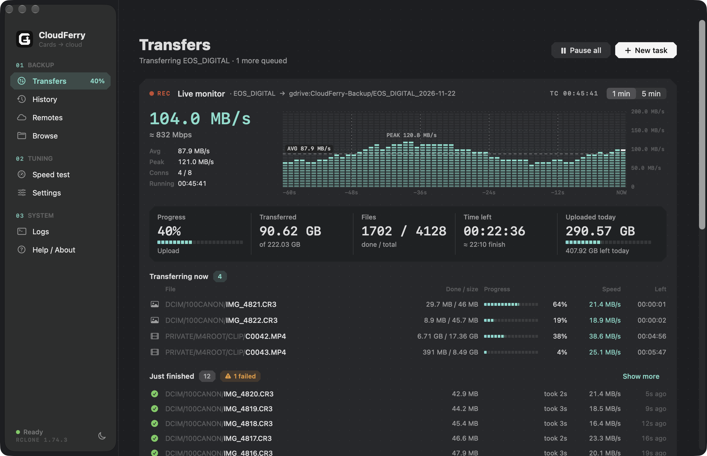
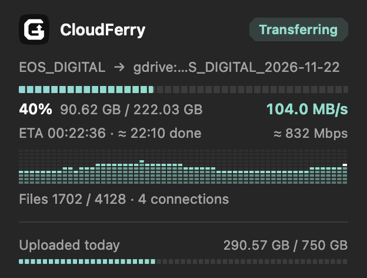

<p align="center">
  
</p>

<h1 align="center">CloudFerry</h1>

<p align="center">
  <b>Back up camera cards to Google Drive at full speed.</b><br>
  A free, native macOS app for photographers and filmmakers, powered by <a href="https://rclone.org">rclone</a>.
</p>

<p align="center">
  <a href="https://github.com/brendanc321/CloudFerry/releases/latest"><b>⬇︎ Download for Mac</b></a>
  &nbsp;·&nbsp; macOS 13+ &nbsp;·&nbsp; Apple Silicon &nbsp;·&nbsp; MIT License
</p>

<p align="center">
  
</p>

---

## What is it?

You come back from a shoot with a stack of memory cards. You want them safely in the cloud **tonight**, without first copying 500 GB onto a laptop that doesn't have the space.

CloudFerry streams your cards and SSDs **straight to Google Drive** with many parallel connections, checks every file afterwards, and tells you when a card is safe to format. Plug in a few cards, queue them up, go to bed.

Under the hood it drives [rclone](https://rclone.org), the open-source "Swiss army knife" of cloud storage, so it also works with the 70+ other clouds rclone supports. You never have to touch the Terminal.

## Features

**Backup**
- **Drop a card, it's on its way.** Drag a card, folder or file onto the window or the Dock icon. Files go directly from the card to the cloud, with no local copy and no disk space needed.
- **Multi-card queue for overnight runs.** Drag to reorder, pause or resume single tasks, and the Mac is kept awake while transferring.
- **Cards never overwrite each other.** Every card gets its own `CardName_date` folder (all cameras name their cards `EOS_DIGITAL` or `Untitled`…). Plugging the same card in again the same day only uploads what's new.
- **Verified uploads.** After each backup CloudFerry compares the cloud copy with the card and shows a **"verified, safe to format"** badge.
- **Knows Google Drive's limits.** When the ~750 GB/day upload cap is reached it pauses and resumes by itself the next day. It retries automatically after network errors, and resumes where it left off after a crash or reboot.
- **Auto-detects cards** when you plug them in, and offers a one-click backup (optional).

**Live monitor**
- Speed in **MB/s and Mbps**, an LED-style throughput meter (1 min / 5 min), average and peak speed, and an ETA with the finish time.
- Every file in flight with its own progress and speed, plus a list of files just finished, including failures.
- **Menu bar panel** and **Dock badge**, so you can follow progress without opening the window.

**Finder-style cloud browser**
- Browse your Drive with **photo and video thumbnails**, in icon or list view.
- **Quick Look** with the Space bar: view photos, and **stream videos** without downloading them first (scrubbing works).
- **Drag & drop like Finder:**
  - drop files from Finder to upload;
  - drag items out to Finder to download;
  - drag onto a folder to move.
- Rename, new folder, move to Drive Trash, calculate folder size, and open in Google Drive on the web.

**Sharing**
- **Shared with me:** browse, preview and download what others shared with you, and upload into folders you can edit.
- **Open any Google Drive link** a friend sends you.
- **Share your own files and folders:**
  - "anyone with the link" (viewer or editor), or invite people by email;
  - see who has access and remove them;
  - copy the link.

**And also**
- **Speed test** that measures your real upload speed to the cloud and recommends settings.
- **History** of every backup, with CSV export.
- **Logs** that explain what went wrong in plain words.
- **Themes:** Light, Dark, and **Dark glass** (macOS Liquid Glass).
- **Language:** English, with Simplified Chinese available at the bottom of Settings.
- **Your own Google client:** a guided wizard to connect with your own Google OAuth client. It is faster and more reliable than rclone's shared default (see below).

<p align="center">
  
</p>

<p align="center">
  
  &nbsp;
  
</p>

## Install

1. Download **`CloudFerry-x.y.z-arm64.dmg`** from the [latest release](https://github.com/brendanc321/CloudFerry/releases/latest).
2. Open it and drag **CloudFerry** into **Applications**.
3. **First launch.** CloudFerry is free and open source, but it isn't notarized by Apple (that requires a paid developer account), so macOS blocks it the first time:
   - Open CloudFerry once. When macOS says it can't verify the app, click **Done**.
   - Go to **System Settings → Privacy & Security**, scroll down to *"CloudFerry was blocked…"*, click **Open Anyway** and confirm.
   - *Or* run this once in Terminal:
     ```bash
     xattr -dr com.apple.quarantine /Applications/CloudFerry.app
     ```

**Requirements:** macOS 13 Ventura or later on an Apple Silicon Mac (M1 or newer). rclone is built in, so there's nothing else to install.

## Getting started

1. **Connect Google Drive.** Open **Remotes → Add remote** (or **Settings → Connect…**), sign in to Google in your browser and click Allow. That's it.
   > **Recommended:** under Remotes, choose **"Use your own Google client"**. rclone's built-in Google client is shared by every rclone user worldwide, so it's rate-limited, and rclone has warned it may stop working. The wizard walks you through creating your own free client in the Google Cloud Console (about 5 minutes) and switches over safely. If anything fails, your old login is kept.
2. **Back up a card.** Plug it in and click **Back up**, or drag the card onto the window or the Dock icon.
3. **Wait for the green badge.** "Verified" means every file on the card matches the cloud copy.

## Good to know

- **Google's daily limit.** Google Drive accepts about **750 GB of uploads per account per day**. CloudFerry pauses at the limit and continues the next day automatically.
- **Big single files.** Many files upload in parallel, but Google Drive uploads **one file over a single connection**. A single huge video goes as fast as one connection allows.
- **Whose storage does a shared upload use?** In Google Drive, files count against the storage of the person who **uploads** (owns) them. If a friend uploads into your shared folder, it uses *their* storage, and vice versa.
- **Keep your Mac awake and online** for overnight runs. CloudFerry prevents sleep while transferring, but a closed laptop lid on battery will still sleep.

## Privacy

CloudFerry has **no servers, no accounts, no analytics and no telemetry**.

- **Your Google sign-in stays on your Mac.** It lives in your local rclone config (`~/.config/rclone/rclone.conf`).
- **Your files go directly** from your Mac to your cloud.
- **Thumbnails and sharing** use Google's API directly from your Mac with your own sign-in.

## Build from source

You need the Xcode Command Line Tools (`xcode-select --install`). No Xcode project is required.

```bash
git clone https://github.com/brendanc321/CloudFerry.git
cd CloudFerry
./Scripts/build_app.sh        # downloads rclone (checksum-verified), builds build/CloudFerry.app
open build/CloudFerry.app
./Scripts/make_dmg.sh         # optional: package a DMG
```

The app is written in Swift with AppKit, with no third-party Swift dependencies. It runs `rclone rcd` locally (127.0.0.1, random port and password) and talks to it over rclone's remote-control API.

## Contributing

Bug reports, ideas and pull requests are welcome. Please [open an issue](https://github.com/brendanc321/CloudFerry/issues).

**If CloudFerry saves you time, please give it a ⭐️. It really helps others find it.**

## Credits & license

- CloudFerry is released under the [MIT License](LICENSE).
- It bundles [rclone](https://rclone.org) (MIT License, © Nick Craig-Wood and contributors); see [THIRD_PARTY_NOTICES.md](THIRD_PARTY_NOTICES.md).
- CloudFerry is an independent project. It is not affiliated with or endorsed by Google. Google Drive is a trademark of Google LLC.
