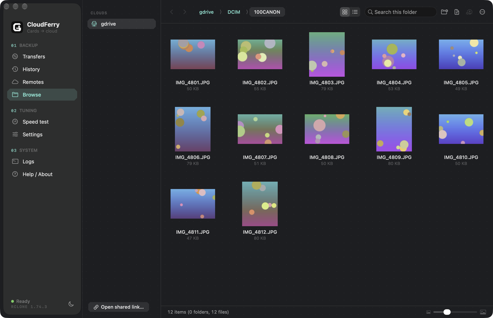
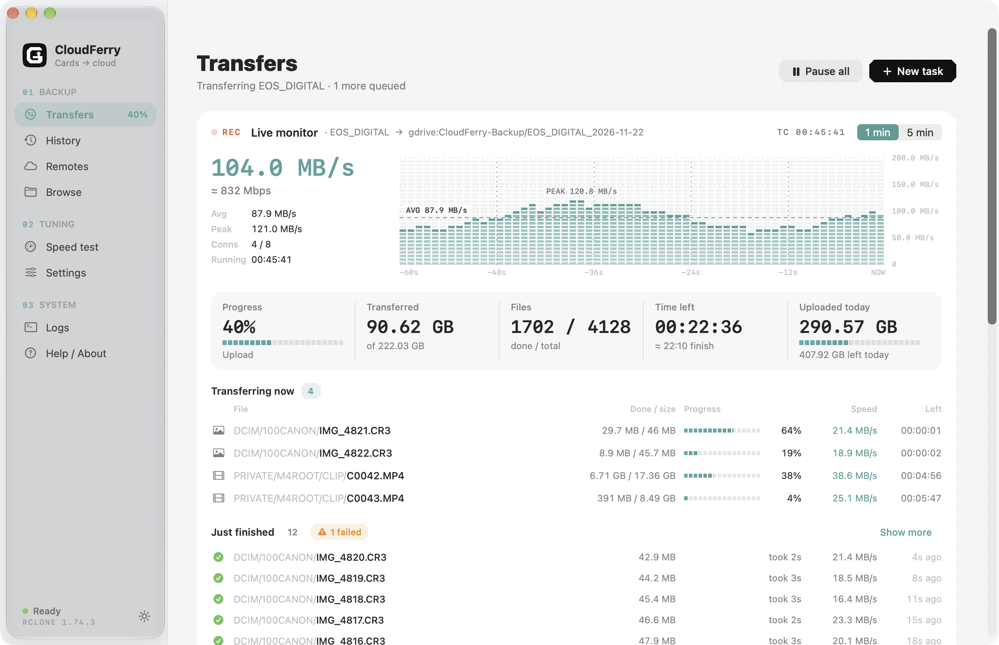

<p align="center">
  
</p>

<h1 align="center">CloudFerry — the fast Google Drive client for Mac</h1>

<p align="center">
  <b>Upload and download Google Drive at full broadband speed. Browse it like Finder. Free and open source.</b><br>
  Multi-threaded Google Drive uploader &amp; downloader · Finder-style Drive browser · SD card / SSD backup · native macOS app powered by <a href="https://rclone.org">rclone</a>
</p>

<p align="center">
  <a href="https://github.com/brendanc321/CloudFerry/releases/latest"><b>⬇︎ Download CloudFerry for Mac (free)</b></a>
  &nbsp;·&nbsp; macOS 13+ · Apple Silicon · MIT License
  &nbsp;·&nbsp; <a href="https://brendanc321.github.io/cloudferry-site/">Website</a>
</p>

<p align="center">
  
</p>

---

### Google Drive on a Mac shouldn't feel like this
- 🐢 **"I pay for 1–2 Gbps. Why do my uploads crawl at a few hundred Mbps?"**
  - The Google Drive website and app move only a handful of files at a time, and each file waits for its own start-up and confirmation, so your fast line and fast Mac sit idle between files.
  - With **thousands of photos** it's worse: the speed graph bounces up and down like a heartbeat.
  - CloudFerry keeps dozens of files in flight and checks them in parallel, so your connection stays full.
- 💾 **"Google Drive for desktop is eating my Mac."**
  - The official app keeps a local cache that often shows up as tens or hundreds of GB of mysterious **"System Data"** in Storage settings.
  - CloudFerry stores nothing: no sync, no cache, files stream straight to and from the cloud.
- 🧩 **"My download came as 12 zip files."** Drag the folder to Finder instead. It arrives as a folder, at full speed.
- 🖱 **"Managing files in a browser tab is painful."** You get a Finder-style window with thumbnails, Quick Look and drag & drop.
- 😵 **"Did everything actually upload?"** Every file is verified, with a "safe to format" badge.

**CloudFerry fixes all of it, and lets you use Google Drive the way you use Finder.** ⚡ [Run the live speed check](https://brendanc321.github.io/cloudferry-site/#speedcheck) to see what parallel transfers can do on your connection.

**CloudFerry is a free, open-source Google Drive client for macOS that's built for speed.** It moves files to and from Google Drive with **up to 32 parallel transfers** and **multi-threaded downloads**, so it can **max out a gigabit (or faster) home connection**. There's no syncing, no local cache and no Terminal.

On top of that you get:
- a **Finder-style Google Drive browser** with photo and video thumbnails, Quick Look and video streaming;
- **Shared with me** and **link sharing** built in;
- a "set it and forget it" **backup queue** for SD cards, SSDs and huge folders that verifies every file when it's done.

Under the hood CloudFerry drives [rclone](https://rclone.org), the battle-tested open-source engine for cloud storage. So it also works with **Dropbox, OneDrive, Amazon S3, Backblaze B2, Cloudflare R2, SFTP and 70+ other clouds**, all through a native Mac interface.

## Why CloudFerry?

- 🚀 **Full-speed transfers.**
  - Up to 32 files move at once, and big downloads are split into parallel streams.
  - Upload chunk sizes and buffers are tuned for Google Drive.
  - A built-in speed test measures your real line and recommends the best settings.
- 💾 **No sync, no cache, no wasted disk space.** Files stream directly between your disk and Google Drive. Back up a 1 TB card from a laptop with 50 GB free.
- 🗂 **A real file manager for Google Drive:**
  - icon or list view with thumbnails;
  - Space-bar Quick Look and video streaming;
  - drag & drop to upload, download or move;
  - rename, new folder, folder sizes, Trash.
- 🤝 **Sharing built in:**
  - Shared with me;
  - open any Google Drive link a friend sends you;
  - share by link or email, and see and remove who has access.
- 🌙 **Set it and forget it.**
  - Queue several drives and leave it overnight. CloudFerry handles Google's 750 GB/day upload cap by itself (pauses, then resumes the next day).
  - It retries network errors and resumes after a crash or reboot.
  - It **verifies every file** when it's done.
- 🔒 **Private by design.** There are no servers, no accounts and no telemetry. Your Google sign-in never leaves your Mac.
- ✨ **Native and beautiful.**
  - Swift + AppKit, menu bar panel and Dock progress;
  - Light, Dark and **Liquid Glass** themes;
  - English and Simplified Chinese.

## Who is it for?

Anyone who moves **a lot of data** in or out of Google Drive:
- **Photographers & filmmakers:** back up memory cards and SSDs straight to Drive, with a "safe to format" check.
- **Video editors, music producers, 3D artists:** upload project folders and multi-gigabyte renders without babysitting a browser tab.
- **Anyone downloading big shared folders:** clients, collaborators or friends sending you a Drive link. Grab the whole folder at full speed.
- **Families & home users:** get years of photo libraries off old drives and into the cloud.
- **Researchers, IT & power users:** migrate datasets, archives and whole drives, or get a GUI for rclone on macOS.

## Features

### Speed & transfers
- **Multi-threaded Google Drive uploads and downloads:**
  - up to 32 parallel file transfers;
  - parallel streams for large downloads;
  - tunable chunk size, buffers and API request rate.
- **One-click presets:** Balanced, *many small files* (photo cards), *single huge file* (video), *overnight multi-drive*.
- **Speed test** against your real cloud, with recommended settings.
- **Bandwidth limit with a schedule** (e.g. slow during the day, full speed at night).
- **Skips system junk** (`.DS_Store`, `.Spotlight-V100`, `._*` …) and supports custom filters.

### Google Drive browser (Finder-style)
- **Thumbnails** for photos and videos (with video duration), in icon or list view, with adjustable size.
- **Quick Look** (Space): view images and **stream videos without downloading**; scrubbing works.
- **Drag & drop:**
  - drop from Finder to **upload**;
  - drag to Finder to **download**;
  - drop onto a folder to **move**.
- Rename, new folder, calculate folder size, Get Info, copy path, open in Google Drive on the web, move to Drive Trash.
- Back / forward, clickable path bar, search, sort, keyboard shortcuts (⌘[ ⌘] ⌘↑ ⌘I ⇧⌘N ⌘⌫).

### Sharing
- **Shared with me:** browse, preview and download files others shared with you, and **upload into shared folders** you can edit.
- **Open a Google Drive link:** paste a folder link to browse it, or a file link to download it.
- **Share files and folders:**
  - "Anyone with the link" (viewer or editor), or invite people by email (viewer / commenter / editor);
  - see who has access, remove them, copy the link.

### Backup & safety
- **Drop a drive, it's on its way:** drag cards, folders or files onto the window or the Dock icon, or let CloudFerry **auto-detect** cards when you plug them in.
- **No overwrites:** each card goes into its own `CardName_date` folder. Backing up the same card again the same day only uploads what's new.
- **Verification** after every upload, with a "Verified, safe to format" badge.
- **Google Drive's 750 GB/day limit** is detected and handled automatically.
- **Auto-retry** (2 / 10 / 30 min), single-task pause, drag-to-reorder queue, resume after crash, keeps the Mac awake.

### Monitoring
- **Live monitor:**
  - speed in MB/s and Mbps, with an LED throughput meter (1 / 5 min);
  - average, peak, active connections, ETA and finish time.
- **Per-file view:** every file in flight with progress and speed, plus recently finished files including failures.
- **Menu bar panel**, **Dock badge** and notifications.
- **History** of every transfer (CSV export) and readable **logs**.

### Clouds & accounts
- **Google Drive:**
  - one-click sign-in in your browser;
  - a **wizard to use your own Google OAuth client**, for higher limits and better reliability;
  - safe credential switching that never loses your working login.
- **Any rclone remote:** Dropbox, OneDrive, S3, B2, R2, SFTP, WebDAV, pCloud, Box and more. Cloud-to-cloud copies are supported too.

<p align="center">
  
</p>

<p align="center">
  
  &nbsp;
  
</p>

## How does it compare?

|  | **CloudFerry** | Google Drive for desktop | drive.google.com in a browser | rclone (command line) |
|---|:---:|:---:|:---:|:---:|
| Uploads straight from a card / SSD without copying to your Mac first | ✅ | ❌ (uses a local cache) | ✅ | ✅ |
| Tunable parallel transfers (up to 32) and multi-threaded downloads | ✅ | ❌ | ❌ | ✅ |
| Upload queue that survives restarts and handles the 750 GB/day cap | ✅ | ⚠️ | ❌ | ⚠️ (flags / scripts) |
| Verifies every file after upload | ✅ | ❌ | ❌ | ✅ (`rclone check`) |
| Thumbnails, Quick Look and video streaming | ✅ | ✅ (via Finder) | ✅ | ❌ |
| Shared with me, open links, manage sharing | ✅ | ⚠️ | ✅ | ⚠️ |
| Works with 70+ other clouds | ✅ | ❌ | ❌ | ✅ |
| No Terminal needed | ✅ | ✅ | ✅ | ❌ |
| Free & open source | ✅ (MIT) | Free | Free | ✅ (MIT) |

*Real-world speed depends on your connection, your disk and Google's limits. Google Drive uploads each single file over one connection; parallelism comes from moving many files at once and from parallel streams on downloads.*

## Install

1. Download **`CloudFerry-x.y.z-arm64.dmg`** from the [latest release](https://github.com/brendanc321/CloudFerry/releases/latest).
2. Open it and drag **CloudFerry** into **Applications**.
3. **First launch.** CloudFerry is free and open source, but it isn't notarized by Apple (that requires a paid developer account), so macOS blocks it the first time:
   - Open CloudFerry once. When macOS says it can't verify the app, click **Done**.
   - Go to **System Settings → Privacy & Security**, scroll down to *"CloudFerry was blocked…"*, click **Open Anyway** and confirm.
   - *Or* run once in Terminal:
     ```bash
     xattr -dr com.apple.quarantine /Applications/CloudFerry.app
     ```

**Requirements:** macOS 13 Ventura or later on Apple Silicon (M1 or newer). rclone is built in, so there's nothing else to install.

## Getting started

1. **Connect Google Drive.** Open **Remotes → Add remote** (or **Settings → Connect…**), sign in to Google in your browser and click Allow.
   > **Recommended:** under Remotes, choose **"Use your own Google client"**. rclone's built-in Google client is shared by every rclone user worldwide, so it's rate-limited, and rclone has warned it may stop working. The wizard walks you through creating your own free client in the Google Cloud Console (about 5 minutes) and switches over safely.
2. **Upload:** drag files, folders or a whole card onto the window, or onto any folder in **Browse**.
3. **Download:** in **Browse**, drag files or folders to Finder, or right-click → *Download to…*.
4. **Pick a preset** in **Settings** (or run **Speed test**) to max out your connection.

## FAQ

**What is the fastest way to upload large files to Google Drive on a Mac?**
Use a client that uploads many files in parallel and doesn't copy files into a local cache first. CloudFerry runs up to 32 transfers at once with Drive-tuned chunk sizes, so folders with many files (photo cards, projects, archives) can saturate a fast home connection.

**How do I download an entire Google Drive folder quickly, without it being zipped?**
Open the folder in CloudFerry's **Browse** tab and drag it to Finder, or right-click → *Download to…*. Files download in parallel, large files use multiple streams, and there's no zip-and-wait step.

**How do I stop `.DS_Store` and `._` files from uploading to Google Drive?**
CloudFerry filters system junk automatically: `.DS_Store`, `._*` (AppleDouble), `.Spotlight-V100`, `.fseventsd`, `.Trashes`, `.TemporaryItems`, `Thumbs.db`, `desktop.ini` and more. You can turn it off in Settings.

**Why is my Google Drive upload only a few hundred Mbps when I have gigabit internet?**
The Google Drive website and desktop app move only a few files at a time, and each file waits for its own start-up and confirmation, so a fast line sits idle between files. This is especially bad with thousands of small photos, where the speed bounces up and down. CloudFerry keeps dozens of files in flight and checks them in parallel, so the connection stays full.

**Why does Google Drive for desktop take up so much "System Data" on my Mac?**
The official app keeps a local cache of your Drive, which macOS often counts as "System Data" in Storage settings. CloudFerry doesn't sync or cache anything: files stream directly between your disk and Google Drive.

**How fast can I upload to Google Drive with my internet?**
Try the [live speed check](https://brendanc321.github.io/cloudferry-site/#speedcheck). It measures one connection against many in parallel, recommends a CloudFerry preset, and estimates how long a card or a terabyte will take. Inside the app, **Speed test** measures your real speed to your own Drive.

**Does it mount Google Drive as a disk?**
Not as a mounted volume. CloudFerry gives you a Finder-style window for Google Drive, with thumbnails, Quick Look and drag & drop, without syncing or caching anything on your disk.

**Is there a Google Drive app for Mac that doesn't sync?**
Yes. CloudFerry doesn't mirror or cache your Drive. You browse it like Finder and only transfer what you choose, so it uses no extra disk space.

**Can I back up an SD card or SSD directly to Google Drive?**
Yes. Plug it in and click **Back up** (or drag it onto the window). Files stream straight from the card to Drive, go into a `CardName_date` folder, and are verified afterwards so you know the card is safe to format.

**How do I access "Shared with me" files or open a Google Drive link on Mac?**
Click **Shared with me** in the Browse sidebar, or **Open shared link…** and paste the link. You can preview, download, and upload into folders you have edit access to.

**What is Google Drive's 750 GB daily upload limit?**
Google allows each account to upload about 750 GB per day. CloudFerry detects when you hit it, pauses the queue, and resumes automatically the next day.

**When I upload into someone else's shared folder, whose storage does it use?**
In Google Drive, files count against the storage of whoever **uploads (owns)** them. Uploading into a friend's folder uses your storage, and a friend uploading into yours uses theirs.

**Is CloudFerry a GUI for rclone?**
Yes. It's a native macOS front-end for rclone. It bundles the official rclone binary and talks to it locally, so you get rclone's power and reliability without the command line. It also works with your existing rclone remotes.

**Does it work with Dropbox, OneDrive, S3 or other clouds?**
Yes, with any cloud rclone supports (70+). Some extras, like thumbnails, sharing and Shared with me, are Google Drive specific.

**Is it safe? Where are my credentials stored?**
CloudFerry has no servers and no telemetry. Your Google sign-in is stored only in your local rclone config (`~/.config/rclone/rclone.conf`), and files go directly between your Mac and your cloud. The code is open source, so you can check it.

**Why does macOS say it can't verify CloudFerry?**
The app is free and not notarized by Apple. Allow it once in **System Settings → Privacy & Security → Open Anyway** (see [Install](#install)).

**Does it run on Intel Macs or Windows?**
Currently Apple Silicon Macs on macOS 13+. Intel and Windows builds are not available yet.

## Privacy

There are **no servers, no accounts, no analytics and no telemetry**.

- **Your sign-in stays on your Mac.** Google tokens live in your local rclone config.
- **Your files go directly** from your Mac to your cloud.
- **Thumbnails and sharing** call Google's API from your Mac with your own sign-in.

## Build from source

You need the Xcode Command Line Tools (`xcode-select --install`). No Xcode project is required.

```bash
git clone https://github.com/brendanc321/CloudFerry.git
cd CloudFerry
./Scripts/build_app.sh        # downloads rclone (checksum-verified), builds build/CloudFerry.app
open build/CloudFerry.app
./Scripts/make_dmg.sh         # optional: package a DMG
```

The app is written in Swift with AppKit, with no third-party Swift dependencies. It runs `rclone rcd` on 127.0.0.1 with a random port and password, and controls it through rclone's remote-control API.

## Contributing & support

Bug reports, feature ideas and pull requests are welcome. Please [open an issue](https://github.com/brendanc321/CloudFerry/issues).

### ⭐️ If CloudFerry saves you time, please star the repo. It helps other people find it.

## Credits & license

- CloudFerry is released under the [MIT License](LICENSE).
- It bundles [rclone](https://rclone.org) (MIT License, © Nick Craig-Wood and contributors); see [THIRD_PARTY_NOTICES.md](THIRD_PARTY_NOTICES.md).
- CloudFerry is an independent project. It is not affiliated with or endorsed by Google, Dropbox, Microsoft or Amazon. Google Drive is a trademark of Google LLC.

<details>
<summary><b>简体中文简介</b></summary>

**CloudFerry 是一款免费开源的 Mac 版 Google Drive（谷歌云端硬盘）客户端，主打速度。**
- **多线程上传和下载**：最多 32 个文件同时传输，大文件下载自动分成多条连接，能把家里的千兆宽带跑满；不同步、不占本机缓存，不用命令行。
- **像访达一样浏览谷歌网盘**：图片和视频有缩略图，空格键预览，视频在线播放；拖放就能上传、下载、移动。
- **共享功能齐全**：可以浏览「与我共享」，打开朋友发来的分享链接直接下载，也能把文件夹共享给别人。
- **备份储存卡和移动硬盘**：一键把 SD 卡、SSD 备份到谷歌网盘，多卡排队整夜挂机，自动处理每天 750 GB 的上传上限，传完逐个核对文件。
- **其他云盘**：基于 rclone，同样支持 Dropbox、OneDrive、S3 等 70 多种云存储。
- **切换中文界面**：Settings → Language（设置页最底部）。

下载：[Releases](https://github.com/brendanc321/CloudFerry/releases/latest)

</details>
